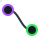
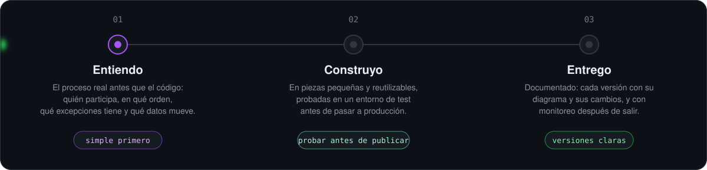
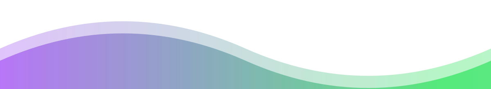

<div align="center">



<h1>


</h1>

<p>


</p>


</div>

##  &nbsp;01 — Quién soy

Ingeniero en Telecomunicaciones, Sistemas y Electrónica por la UNAM. Desarrollo soluciones que unen software y hardware: automatización de procesos, APIs e interfaces web, y sistemas electrónicos. Me interesa llevar una idea hasta el sistema funcionando, integrando cada una de sus partes.

```txt
▸ Flujos de automatización     n8n · webhooks · agentes de IA
▸ APIs y servicios backend     Node.js · Express · bases de datos
▸ Frontend e interfaces web    HTML · CSS · JavaScript · WebSocket
▸ Electrónica y embebidos      Microcontroladores · FPGA · PCB
▸ Redes neuronales             Visión artificial · datos de sensores
▸ Diseño y modelado 3D         Modelado e impresión 3D
```

<details>
<summary><b>Publicaciones</b></summary>

<br/>

- **Web Interface Design for the Intelligent Management of a Differential Robot Applied to IoT Systems** — XXVII Robotics Mexican Congress (COMRob), 2025. Interfaz web en tiempo real sobre ESP32 y WebSocket, con control manual, navegación autónoma y seguimiento de trayectorias. [DOI](https://doi.org/10.1109/COMRob68109.2025.11264804)
- **Red neuronal convolucional para control de activación y paro de un dispositivo electrónico** — visión artificial con ESP32-CAM y una CNN entrenada con base de datos propia, con una eficacia del 85 % al 90 %. Pädi, Boletín Científico de Ciencias Básicas e Ingenierías del ICBI, vol. 14, núm. 27, 2026.

</details>

##  &nbsp;02 — Cómo trabajo



##  &nbsp;03 — En lo que he trabajado

| Tipo | Proyecto | Qué involucra | Stack |
|---|---|---|---|
| 🟢 Frontend | **Portal de levantamientos y documentos** | Aplicación web donde el personal en campo captura levantamientos y los equipos consultan documentos. Vistas por rol, carga de archivos, conexión directa con flujos de n8n y despliegue automático en cada versión. | Node.js · Tailwind · n8n |
| 🟢 Backend | **API de solicitudes y visitadores** | Servicio que gobierna el ciclo completo de una solicitud: alta, estados, órdenes de trabajo y asignación de visitadores. Concentra las reglas de negocio que consumen el portal y los flujos. | Node.js · REST · base de datos |
| 🟢 Automatización | **Reclutamiento automatizado** | Un solo webhook recibe todos los eventos del sistema de reclutamiento y los enruta por recurso, vacante y acción hacia subflujos. Crea carpetas en Drive por tipo de vacante, valida requisitos en vivo y avisa por Slack. | n8n · Teamtailor · Drive · Slack |
| 🟢 Automatización | **Descarga de archivos por orden de trabajo** | El portal funciona como puente transparente hacia un flujo que reúne los archivos de cada orden y los entrega paginados en bloques de 20 MB, sin exponer identificadores internos. | n8n · Drive · portal web |
| 🟢 Automatización | **Viáticos y tiempos de traslado** | Calcula distancia y tiempo de cada visita con Distance Matrix, tiene cálculo alterno cuando el dato no llega y verifica los requisitos del visitador antes de autorizar el viático. | n8n · Distance Matrix · Teamtailor |
| 🟢 Agentes de IA | **Asistentes de WhatsApp y de voz** | Conversaciones automatizadas por WhatsApp con Treble y por llamada con bots de Vapi, conectadas a flujos que consultan datos, registran la información y derivan a una persona cuando hace falta. | Treble · Vapi · n8n |
| 🟣 Electrónica | **Robot diferencial con interfaz web** | Diseño completo del sistema: chasis modelado e impreso en 3D, circuito, firmware en MicroPython e interfaz web en tiempo real. Opera de forma manual, navega a coordenadas o sigue una trayectoria dibujada en pantalla, con odometría e IMU.<br/><sub>Publicado en IEEE COMRob 2025.</sub> | ESP32 · MicroPython · WebSocket · JavaScript |
| 🟣 Modelado 3D | **Diseño e impresión 3D** | Piezas y objetos diseñados desde cero e impresos por cuenta propia, como trabajo independiente: de la idea al objeto físico, con modelado paramétrico y orgánico, y laminado para impresión. | Shapr3D · Blender · Nomad Sculpt · Bambu Studio |
| 🟣 Redes neuronales | **Visión artificial y redes pequeñas** | Una ESP32-CAM envía imágenes a una CNN que decide si activar o detener un robot, con 85 % a 90 % de eficacia sobre una base de datos propia. También entrené redes neuronales compactas que interpretan información de sensores.<br/><sub>Publicado en Pädi, Boletín Científico de Ciencias Básicas e Ingenierías del ICBI, vol. 14, núm. 27, 2026.</sub> | ESP32-CAM · MATLAB · CNN |

<sub>🟢 trabajo profesional en producción · 🟣 proyectos académicos, de investigación y trabajo independiente. El código de los proyectos profesionales es privado.</sub>

##  &nbsp;04 — Stack

<div align="center">


<br/><br/>


</div>

##  &nbsp;05 — Actividad

<div align="center">


<picture>
  <source media="(prefers-color-scheme: dark)" srcset="https://raw.githubusercontent.com/Mario-IY/Mario-IY/output/snake-dark.svg" />
  <source media="(prefers-color-scheme: light)" srcset="https://raw.githubusercontent.com/Mario-IY/Mario-IY/output/snake.svg" />
  
</picture>


<sub><i>Thought creates; the act inscribes it in time.</i></sub>



</div>
